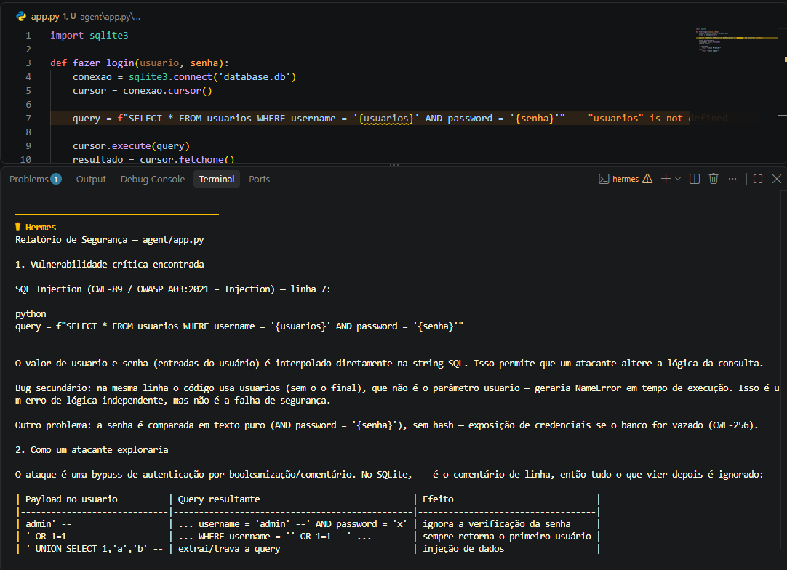
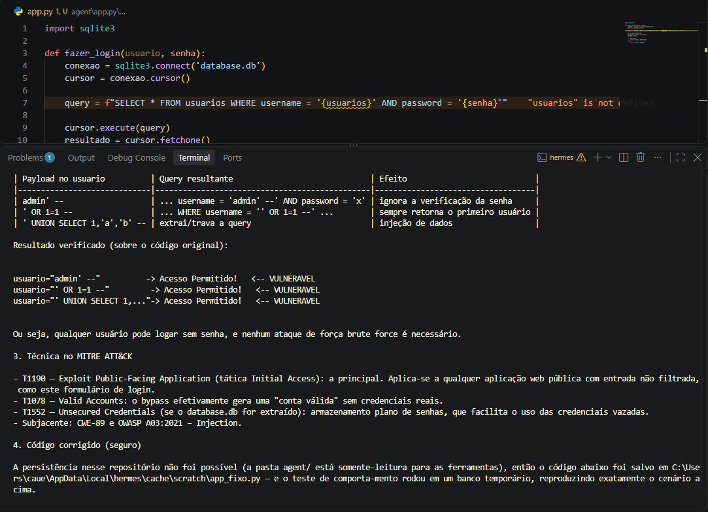

# 🛡️ sec-agent

> Um agente de IA especializado em cibersegurança. Ele não responde direto: **entende o contexto, avalia impacto, probabilidade e severidade, e só então orienta a correção**, como um profissional de segurança faria.

Nenhum modelo foi treinado aqui. O agente aprende pelo que está escrito em arquivos Markdown: uma persona, uma base de conhecimento e uma skill. Qualquer harness compatível com o padrão `AGENTS.md` consegue executá-lo. Neste projeto, usei o **Hermes** pelo terminal do VS Code.

---

## 🎯 A especialização e por quê

Um chat genérico, ao receber um código vulnerável, costuma apontar o erro e entregar a correção na hora. Um profissional de segurança faz diferente: pergunta onde o sistema roda, o que está exposto e que dados ele protege, porque **a mesma falha tem severidade diferente em cada contexto**.

Escolhi cibersegurança porque é uma área em que "responder rápido" é justamente o erro. Ensinei ao agente um processo:

1. Perguntar o contexto antes de agir.
2. Identificar a vulnerabilidade e referenciar CWE, OWASP e MITRE ATT&CK.
3. Explicar a exploração de forma conceitual, só como apoio à defesa.
4. Avaliar impacto, probabilidade e severidade.
5. Orientar a correção e validar com uma nova análise.
6. Entregar um resumo sempre no mesmo formato.

---

## 🧪 Evidências

O teste foi feito com um `app.py` de laboratório, com um login que monta a consulta SQL juntando o que a pessoa digitou (vulnerável a **SQL Injection**). O Hermes, com o agente carregado, analisou o código.

### Análise do código vulnerável





---

## 🗂️ Estrutura do repositório

```
.
├── README.md                              Este guia
├── images/
│   ├── print1.png                         Análise do código vulnerável (parte 1)
│   └── print2.png                         Análise do código vulnerável (parte 2)
│
└── sec-agent/
    ├── AGENTS.md                          Definição do agente (lida pelo harness)
    ├── agent/
    │   ├── persona.md                     Personalidade e tom do agente
    │   └── knowledge/
    │       └── security-basics.md         Fundamentos de segurança
    └── skills/
        └── vulnerability-analysis/
            ├── SKILL.md                   Roteiro que o agente segue
            └── README.md                  Explicação da skill para pessoas
```

## 📄 O que cada arquivo faz

| Arquivo | O que faz |
|---------|-----------|
| `sec-agent/AGENTS.md` | Define quem é o agente, como se comporta, seus limites e a tabela de skills que indica quando usar cada uma |
| `sec-agent/agent/persona.md` | Descreve a postura do mentor: pergunta antes de agir, pensa em risco, ensina o raciocínio e é honesto sobre incertezas |
| `sec-agent/agent/knowledge/security-basics.md` | Base de conhecimento: vulnerabilidade, ameaça, risco, tríade confidencialidade, integridade e disponibilidade, matriz de severidade e boas práticas |
| `sec-agent/skills/vulnerability-analysis/SKILL.md` | O roteiro de 8 etapas da análise, com regras defensivas e o formato fixo de resumo |
| `sec-agent/skills/vulnerability-analysis/README.md` | Explica a skill para quem lê o projeto |

---

## ▶️ Como rodar

1. **Instale o Hermes** seguindo a documentação oficial: <https://hermes-agent.nousresearch.com/docs>
2. **Clone este repositório:**
   ```bash
   git clone https://github.com/SEU-USUARIO/NOME-DO-REPOSITORIO.git
   ```
3. **Entre na pasta do agente** e abra o terminal ali:
   ```bash
   cd NOME-DO-REPOSITORIO/sec-agent
   ```
4. **Rode o agente:**
   ```bash
   hermes
   ```

> ⚠️ **Importante:** rode o `hermes` com o terminal aberto dentro da pasta `sec-agent`. Aberto em outro lugar, ele não encontra o `AGENTS.md` nem os demais arquivos.

### Exemplo de prompt

```
Atue como especialista em AppSec. Analise o app.py abaixo, encontre a falha,
explique como ela seria explorada, cite a técnica do MITRE ATT&CK e me ajude a corrigir.
```

O comportamento esperado é o agente **começar com perguntas de contexto** e só depois analisar.

---

## 🚀 A melhoria escolhida

**Análise sempre no mesmo formato.** Toda análise termina com um resumo padronizado, o que permite comparar casos diferentes lado a lado:

```
## Resumo da análise
- Vulnerabilidade:
- Local:
- Referências (CWE / OWASP / ATT&CK):
- Princípio afetado (C / I / D):
- Impacto:
- Probabilidade:
- Severidade:
- Correção recomendada:
- Status da validação:
```

A severidade segue uma matriz de impacto × probabilidade definida em `security-basics.md`, e sempre vem justificada com o contexto informado.

### Próximos passos

- Skill de testes de segurança.
- Skill de trilha de estudos em cibersegurança.
- Testar com outros cenários: configuração insegura e infraestrutura.
- Levar a revisão para o fluxo de desenvolvimento (DevSecOps).

---

## ⚖️ Aviso ético

Todos os testes usam **apenas código e servidores próprios, de laboratório**. O agente foi instruído a recusar ajuda contra sistemas de terceiros e a manter o foco em defesa.

## 🙏 Créditos

Projeto baseado na estrutura do repositório [digitalinnovationone/dio-agent](https://github.com/digitalinnovationone/dio-agent), da DIO, evoluído com uma especialização própria em cibersegurança.
